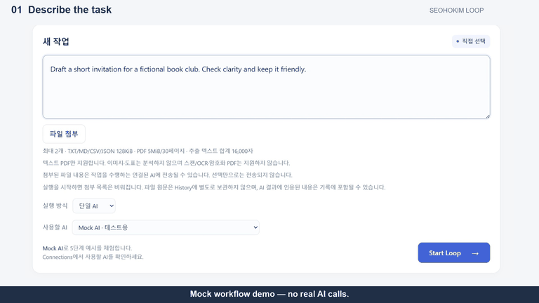

<!-- Copyright 2026 SeohoKim
SPDX-License-Identifier: Apache-2.0
-->

# SeohoKim Loop

**Bring your own AI. Let them work together.**

One request. Multiple AI providers. One collaborative workflow.

자신의 AI를 연결해 자연어 요청을 단계별 작업·검토·개선으로 이어가는 Windows Desktop 앱입니다.
[English](README.md) | [한국어](README.ko.md)

여러 AI 창에 이전 답변을 옮기는 대신, 한 화면에서 요청하고 각 단계의 담당 AI와 결과를 확인합니다.
특정 모델을 새로 만드는 프로젝트가 아니라, 사용자의 API 연결과 로컬 모델을 연결하는 실행 도구입니다.

- 자연어 입력과 단순한 Desktop UI
- Provider별 구현을 분리한 구조와 단계별 결과 전달
- 초안·검토·개선 과정, 취소·실패 상태, 로컬 History와 Markdown Export

### 공식 데모 v0.2

**Mock 실행 데모이며 실제 AI 호출은 없습니다.** 반복되는 미리보기는 실제 Windows 앱의 요청 입력 → Start Loop 클릭 → 단계 진행·결과 확인을 보여줍니다. 한 개의 Mock Provider를 사용하며 실제 다중 AI 협업 실행이 아닙니다.

[](assets/demos/SeohoKim-Loop-Official-Demo-v0.2.mp4)

[전체 데모 보기 (MP4)](assets/demos/SeohoKim-Loop-Official-Demo-v0.2.mp4) — 33초, 1080p, 30fps, 무음, 1.52MiB. GIF: 약 12초 반복, 960KiB.
전체 영상에는 Final Result와 별도로 구분한 초안 → 검토 → 개선 설명이 포함됩니다. 이 설명은 실제 Provider 협업 실행이나 모델 품질 검증 기록이 아닙니다.

**Windows x64 · 소스 Preview · Apache-2.0 · 기본 Mock 데모는 AI 계정 불필요**

이 저장소는 **초기 오픈소스 Preview**입니다. Windows 설치판은 제공하지 않으며,
확인된 자체 소스·설정·문서는 [Apache License 2.0](LICENSE)을 적용합니다. 저작권 표시는 Copyright 2026 SeohoKim입니다.

## 실행

1. Windows x64에서 [공식 Node.js 24.22.1](https://nodejs.org/dist/v24.22.1/)과 함께 제공되는 npm을 설치합니다. `.node-version`은 검증한 버전이며, 패키지는 `>=24.22.1 <25`를 요구합니다.
2. GitHub의 **Code → Download ZIP**으로 소스 ZIP을 받았다면 압축을 풀고 `package.json`이 있는 폴더에서 PowerShell을 엽니다. Git은 clone을 선택할 때만 필요합니다. Windows 설치형 EXE는 제공하지 않습니다.
3. 다음 명령을 실행합니다. 의존성 설치와 최초 Electron 실행 파일 다운로드에는 인터넷이 필요합니다. 이 단계에서 AI API 키나 모델은 필요하지 않습니다.

```powershell
node --version
npm --version
npm ci
npm run dev
```

구버전 Node에서 `EBADENGINE`이 나오면 요구 버전 설치 후 새 터미널에서 버전을 확인하세요.
Electron 다운로드가 실패하면 네트워크·프록시 정책에 따라 npm/GitHub 배포 파일 접근이 가능한지 확인하세요.
보안 검사를 끄거나 출처가 다른 실행 파일로 대체하지 마세요. 처음부터 비어 있는 별도 Windows PC에서의 설치 검증은 아직 완료하지 않았습니다.

오프라인 예시는 **단일 AI → Mock AI → 요청 입력 → Start Loop** 순서입니다.
빌드된 소스를 실행하려면 `npm start`를 사용합니다. 설치 프로그램을 만드는 명령은 아닙니다.

## 직접 해보는 Mock 데모

1. 실행 방식에서 **단일 AI**, Provider에서 **Mock AI**를 선택합니다.
2. 예를 들어 `가상 독서 모임 안내문을 만들어줘`를 입력하고 **Start Loop**를 누릅니다.
3. 요청 이해 → 작업 계획 → 초안 생성 → 결과 검토 → 최종 정리를 거쳐 Final Result와 각 단계의 예시 출력을 확인합니다.

최종 결과에는 Mock 데모이며 실제 조사·분석이나 AI 호출을 수행하지 않았다는 안내가 표시됩니다.
위 영상은 Mock 실행 흐름을 보여줍니다. 실제 두 AI의 응답 품질이나 협업 성공을 증명하는 기록은 아닙니다.

## 개발 검증

```powershell
npm test
npm run typecheck
npm run build
npm run test:desktop
```

테스트는 Fake/Mock과 가상 자료를 사용합니다. 공개 준비본에는 내부 평가 정의·점수·실제 모델 출력·사용자 History가 없으며,
그 기록에만 의존하는 평가 테스트는 제외했습니다. 원본 저장소 전체 테스트와 검사 개수가 다릅니다.
CLI 이벤트와 글자 수 진단의 관련 회귀 테스트는 합성 자료로 유지합니다. Desktop 테스트는 별도 프로필로 백그라운드 실행합니다.

## 기능과 연결

아래는 구현된 기능입니다. API 호환성·모델 품질·지원 플랫폼 전체를 보장하는 목록이 아닙니다.

- Single AI, API 기반 Auto, 직접 선택한 초안·검토·개선 협업
- 단계별 결과·취소·실패 처리, 제한된 Retry/Fallback·병렬 실행
- TXT/MD/CSV/JSON·텍스트 PDF 첨부와 미리보기
- 암호화된 로컬 History, Markdown Export, 선택형 글자 수 진단
- Mock 오프라인 개발, OpenAI-compatible Chat Completions 및 Claude Messages API
- 사용자가 설치한 Ollama 로컬 서버(127.0.0.1:11434). 모델은 별도 설치하며 일반 Auto/Fallback 참여 제한 유지
- Codex CLI 어댑터 소스는 개발용이며 기본 비활성·패키징 배포판 비활성 정책 유지

실제 AI 사용에는 사용자의 API 계정·키 또는 지원되는 로컬 환경이 필요합니다.
앱의 무료 공개 계획이 무료 API나 모든 AI 구독 호환을 뜻하지 않습니다. 연결 확인도 실제 요청을 만들 수 있습니다.
모델·외부 CLI·인증 파일은 포함하지 않습니다. 실제 모델을 호출하는 npm 단축 명령은 공개 준비본에서 제외했습니다.
일부 개발 smoke 도구에 명시적 live 옵션이 있지만 기본 테스트는 이를 사용하지 않습니다.
Ollama를 사용할 때만 [공식 Ollama](https://ollama.com/download/windows)를 별도로 설치하고 사용할 모델의 조건과 저장 공간·RAM/VRAM을 확인하세요.
API 연결만 사용한다면 Ollama나 Codex CLI를 설치할 필요가 없습니다.

## AI 연결 방법

Mock 데모를 확인한 뒤 **Connections**에서 설정합니다.

- **OpenAI-compatible API:** 연결 설정에서 서버 base URL, 지원 모델 ID, 본인 API 키를 입력하고 저장합니다. Chat Completions 형식을 사용하며 모든 전용 API 형식을 지원하지 않습니다.
- **Claude API:** 연결 설정에서 지원 모델 ID와 본인 Anthropic API 키를 입력하고 저장합니다.
- **Ollama:** 별도로 Ollama와 이용 조건을 확인한 모델을 설치합니다. `OLLAMA_NO_CLOUD=1`로 클라우드를 비활성화하고 `127.0.0.1:11434` 로컬 서버를 실행합니다. Connections에서 새로고침한 뒤 설치된 모델을 선택해 저장합니다. 현재 로컬 모델은 첨부 없는 Single AI 텍스트 실행을 지원하며 일반 Auto/Fallback 참여는 비활성입니다.

Single AI로 돌아와 설정한 Provider를 선택한 뒤 요청하세요. API 연결 확인은 유료 요청을 만들 수 있으며, Ollama 새로고침은 서버·모델 정보만 조회합니다. 키를 소스·Issue·스크린샷에 남기지 마세요.
저장된 API 키는 Electron main의 보호 저장소에서 관리합니다. ChatGPT·Claude 소비자 구독만으로 API 이용 권한이 생기는 것은 아닙니다.
현재 앱 UI는 주로 한국어입니다.

## 계획과 검증 범위

- 공개 사본의 결정론적 테스트 1,091개, Typecheck·Build가 통과했습니다. Mock Desktop 실행도 Development·Production에서 확인했습니다.
- 이 결과는 실제 모델의 답변 정확성이나 모든 Provider 버전의 호환성을 인증하지 않습니다.
- 다음 제품 개발 검토 대상은 판매·재고 수치의 결정론적 진단입니다. 공식 OAuth, 추가 CLI 연결, 모델 역할 자동 활성화는 향후 검토 사항입니다.
- Windows 설치판·자동 업데이트·계정·결제·Team 기능은 현재 제공 기능으로 홍보하지 않습니다.

## 개인정보와 한계

Provider 실행과 보호 저장은 Electron main에서 처리합니다. 첨부 자료는 선택한 Provider로 전송될 수 있고,
결과에 인용되면 History·내보낸 Markdown에 남을 수 있습니다. 인증정보·개인 자료를 Issue에 올리지 마세요.
스캔 PDF/OCR·암호화 PDF는 지원하지 않습니다. 협업이 정확성이나 품질 향상을 보장하지 않습니다.
모델 역할 검증 및 Auto 활성화 정책은 원본과 동일합니다. 신규 설치·서명·바이너리 배포는 이 준비본의 범위가 아닙니다.

## 라이선스·기여·보안

적용 대상은 Apache-2.0 SPDX 주석 또는 같은 이름의 `.license` 파일로 표시합니다. [NOTICE](NOTICE)에 적용 범위와 제외 자료를 구분했습니다.
제3자 바이너리 재배포는 별도의 준수 검토가 필요합니다.
[제3자 고지](THIRD_PARTY_NOTICES.md)는 원래 조건을 유지합니다.
[기여 안내](CONTRIBUTING.md)와 [보안 신고 방법](SECURITY.md)를 확인하세요.
취약점은 SECURITY.md에 안내된 비공개 경로로 신고하고, 민감한 내용을 공개 Issue에 올리지 마세요.
타 AI 제공자의 공식 제휴·후원·인증 제품이 아닙니다.

이 프로젝트가 유용하다면 Star로 관심을 표시하거나, 개인정보 없는 재현 사례를 공유해 주세요.
Star 수·사용자 수·품질 개선율을 임의로 제시하지 않으며 Star를 이용 조건으로 요구하지 않습니다.
