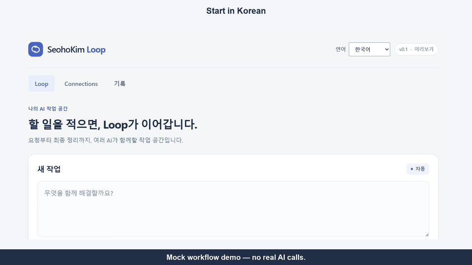

<!-- Copyright 2026 SeohoKim
SPDX-License-Identifier: Apache-2.0
-->

# SeohoKim Loop

**Bring your own AI. Let them work together.**

One request. Multiple AI providers. One collaborative workflow.

A Windows desktop application for natural-language tasks, provider connections and staged draft/review/improvement.
[English](README.md) | [한국어](README.ko.md)

Keep a task and its intermediate results in one place instead of copying replies between AI windows.
Use a simple desktop interface, separate provider adapters, visible step results, cancellation, local history and Markdown export.
This project coordinates existing AI services and local models; it does not train a new model.

### Official demo v0.3

**Mock workflow demo — no real AI calls.** Recorded in the real Windows app: switch from Korean to English, keep a Korean request unchanged, select Mock AI, run the steps and inspect Final Result. This uses one Mock provider, not real multi-AI collaboration.

[](assets/demos/SeohoKim-Loop-Official-Demo-v0.3.mp4)

[Watch the full demo v0.3 (MP4)](assets/demos/SeohoKim-Loop-Official-Demo-v0.3.mp4) — 37.43 seconds, 1920×1080, 30 fps, silent. GIF: 9.69-second loop, 960×540, 716 KiB.
Application Language: **English**. User Request: **Korean**. The interface changes; the original request stays intact. The video does not demonstrate automatic translation of AI responses or claim real-model quality improvement.

Earlier demo v0.2 is preserved: [MP4](assets/demos/SeohoKim-Loop-Official-Demo-v0.2.mp4) · [GIF](assets/demos/SeohoKim-Loop-preview-v0.2.gif). It records the earlier Korean UI.

**Windows x64 · source preview · Apache-2.0 · no AI account needed for the default Mock demo**

This is an early open-source preview, not a Windows installer. Identified project-owned source, configuration and documentation
are licensed under the [Apache License 2.0](LICENSE). Copyright 2026 SeohoKim. Third-party terms remain separate.
See [NOTICE](NOTICE) for scope; applicable files carry SPDX comments or adjacent `.license` files. Third-party binary redistribution requires separate compliance review.

## Quick Start (Windows)

Use Windows x64 and [official Node.js 24.22.1](https://nodejs.org/dist/v24.22.1/) with its bundled npm.
The tested version is pinned in .node-version; the supported package engine range is >=24.22.1 and <25.
On GitHub, choose **Code → Download ZIP**, extract the source ZIP and open PowerShell in the folder containing package.json. Git is needed only if you choose to clone.
Internet access is required for dependency installation and the first Electron binary download. No AI account or model is needed for this setup.

```powershell
node --version
npm --version
npm ci
npm run dev
```

For EBADENGINE, install the required Node version and check it in a new terminal. If the Electron download fails, check approved network/proxy access
to npm and GitHub distribution files. Do not disable security checks or substitute untrusted binaries. A fresh installation on a separate clean Windows PC has not been verified.
`npm start` runs a source build, not an installer. No Windows installer is offered.

## Try the Mock demo

Choose Single AI, select Mock AI, enter a fictional reading-club announcement request and press Start Loop.
The five demo steps cover request understanding, planning, drafting, review and final organization. Inspect the step outputs and Final Result.
The final output explicitly identifies itself as a Mock demonstration with no real research, analysis or AI call.
This demonstrates execution flow, not real-model quality improvement. The video above records the Mock workflow; no real-model demo recording is included. Choose either UI language in the header; select **Single AI / 단일 AI** for this demo.

## Language and original content

Choose **Language → English** or **한국어** in the header. The initial language follows your system language (Korean for Korean locales, English otherwise). Your choice is saved locally and restored after restarting the app. If saving the preference fails, the app explains that it applies for this session only.

Menus, settings, progress, safe errors, History, attachment/PDF preview controls, Markdown export and length diagnostics support both languages. Switching while a task is running changes the interface without restarting it or sending another AI request.

**UI language and AI task language are independent.** User prompts, system instructions, context, attachments, provider/model selection and actual AI responses are not translated or changed by the language selector. Specify a desired response language in your request. Step outputs, Final Result, saved History and exported Markdown retain their original text.

The free Mock demo creates deterministic examples in the language selected when you press **Start Loop**. Completed Mock results and their History entries are not regenerated when you change the interface language. Mock examples are not real AI responses.

The latest v0.3 demo shows the language selector in use. Windows-owned file-dialog controls follow the Windows language.

## Verification

```powershell
npm test
npm run typecheck
npm run build
npm run test:desktop
```

Desktop tests run in the background with isolated profiles. Default tests use fake providers and fictional data.
Internal evaluations, actual model output, history and their dedicated tests are excluded. The test count differs from the private repository.
Relevant CLI-event and writing-constraint regressions use explicitly synthetic data.

## Current scope

These features are implemented; this is not a guarantee of compatibility with every service version or of model answer quality.

Single AI; API-based Auto; selected draft/review/improvement; bounded retry/fallback and parallel execution;
cancellation and failure handling; text/PDF attachments and previews; encrypted local history; Markdown export; optional length diagnostics.
OpenAI-compatible Chat Completions and Claude Messages require the user's API account and key.
Ollama connects to a separately installed local server at 127.0.0.1:11434. General Auto/Fallback restrictions remain unchanged.
Install [official Ollama](https://ollama.com/download/windows) and a suitable model only if using that connection; check model terms, storage and RAM/VRAM requirements.
Ollama and Codex CLI are unnecessary for API-only use.
Codex CLI is disabled at the public application entry point in both development and production. A development environment variable cannot enable it. Its adapter remains available only to deterministic injected tests.
Models, third-party CLI executables, authentication files and dependency binaries are not bundled.

Free application plans do not imply free API calls or compatibility with every AI subscription.
Connection checks can create real requests. Live-generation npm shortcuts are omitted; some developer smoke scripts retain explicit live options,
which default tests do not use. Collaboration does not guarantee correctness or improved quality.
Scanned/OCR and encrypted PDFs are unsupported. Binary redistribution is a separate approval and compliance process.

## Connect your AI

Open **Connections** after trying the Mock demo:

- **OpenAI-compatible API:** choose **Set up connection / 연결 설정**, enter your server base URL, supported model ID and your own API key, then save. The adapter uses Chat Completions, not every vendor-specific endpoint.
- **Claude API:** choose connection settings, enter a supported model ID and your own Anthropic API key, then save.
- **Ollama:** separately install Ollama and a model whose terms you accept, disable its cloud features with `OLLAMA_NO_CLOUD=1`, and run its local server at `127.0.0.1:11434`. In Connections, refresh, select an installed model and save the selection. This preview supports local text-only Single AI; general Auto/Fallback participation remains disabled.

Return to Single AI, select the configured provider and submit your request. API connection-check buttons send a real request and may incur charges; Ollama refresh only reads server/model metadata. Do not paste keys into GitHub issues, source files or screenshots.
Saved API keys are protected through Electron's main-process storage. A ChatGPT or Claude consumer subscription does not automatically provide API access.

## Plans and verification

The prepared source passed 1,188 deterministic tests, Typecheck and Build; Mock Desktop execution was checked in development and production modes.
These checks do not certify real-model accuracy. The next product design topic is deterministic sales/inventory number diagnostics.
Official OAuth, additional CLI adapters and automatic model-role enablement remain future considerations.
Installers, automatic updates, user accounts, billing and Team features are not advertised as current functionality.

## Privacy and contribution

Provider execution and protected storage use the Electron main process. Attachments may be sent to the selected provider;
quoted content may remain in saved or exported results. Do not disclose keys or personal records in issues.
See [third-party notices](THIRD_PARTY_NOTICES.md), [contribution guide](CONTRIBUTING.md) and [security reporting status](SECURITY.md).
Use the private reporting route in SECURITY.md for vulnerabilities; never post sensitive details in public issues.
This application is not officially affiliated with or endorsed by the AI providers.

Consider starring the project if it is useful, or sharing a reproducible example with fictional data.
No invented usage metrics or improvement claims are presented, and Stars are not a condition of use.
